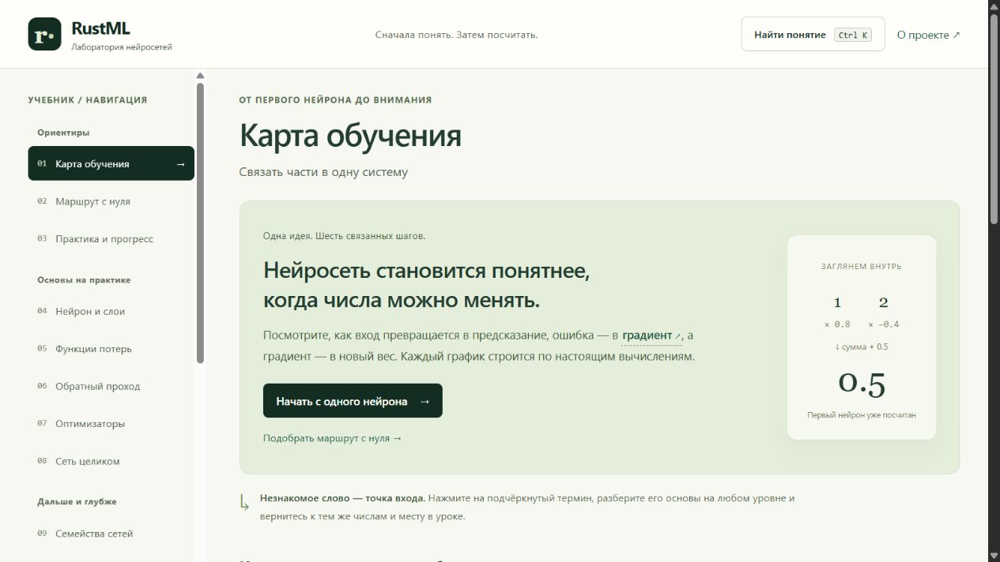
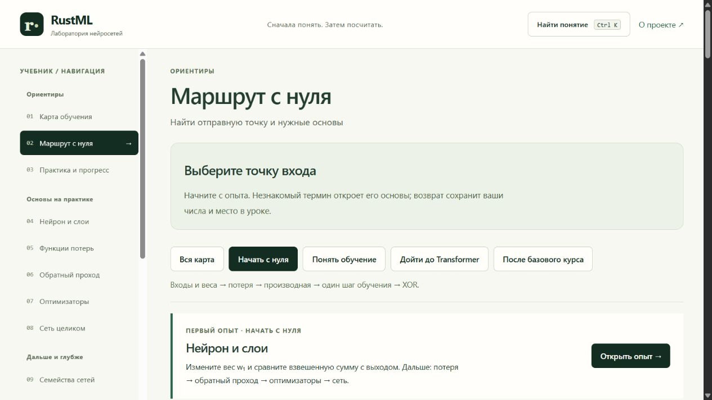
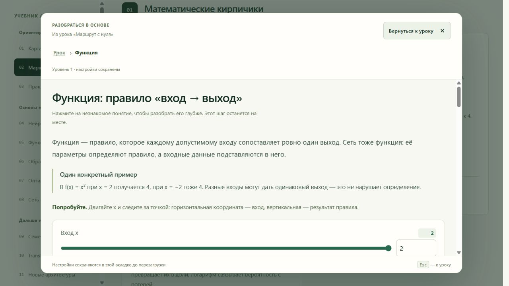
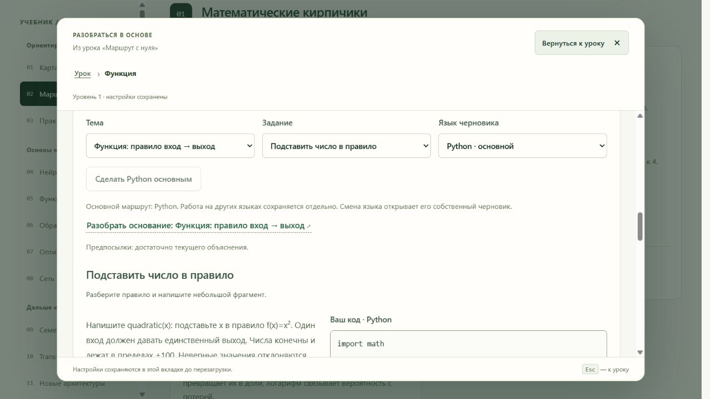
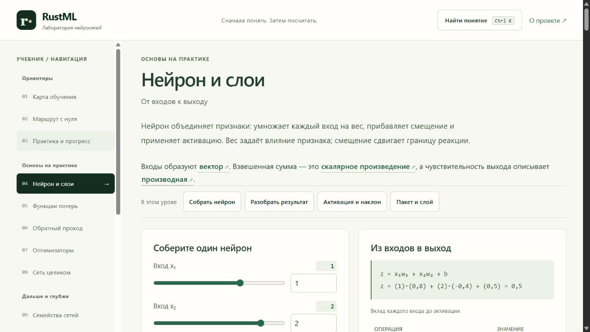
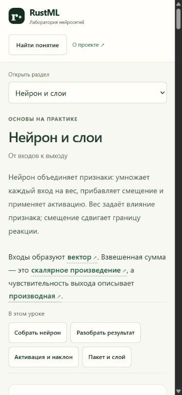

# Как новичок входит в RustML Learning Lab

Дата наблюдений: 14 октября 2026 года. Сайт: https://iliskhan.github.io/rust_ml/. Исходники: `master`, `c95dca43195a7c166b1054956406011d50d284d3`. Объект аудита — вход в учебник, маршрут «Начать с нуля», объяснение функции, практика и первый опыт с нейроном. Это выборочный экспертный разбор пути новичка, а не исследование с участием детей и не проверка всего курса на соответствие WCAG.

**Вывод:** у учебника сильная численная и интерактивная основа, но обещание входа без алгебры пока не обеспечено последовательностью материала. Предполагаемые затруднения школьника основаны на содержании экранов и педагогических исследованиях; фактическая частота ошибок детей ещё не измерена.

## Наблюдавшийся путь

| Шаг | Действие и состояние | Оценка для целевой аудитории |
|---|---|---|
| 1 | Открыта главная страница | Понятный призыв к действию и спокойный интерфейс. Сразу появляются градиент, отрицательные десятичные числа и много направлений навигации. |
| 2 | Открыт «Маршрут с нуля», выбранный по умолчанию маршрут «Начать с нуля» | Выбор маршрута есть. Первый опыт всё равно требует понятия веса и взвешенной суммы; следующие опоры начинаются с векторов и матриц. |
| 3 | Открыта «Функция» из математических основ | Определение, пример, график и подробности связаны. Пример `f(x)=x²` требует не объяснённых здесь символов, степени, отрицательных чисел и координат. |
| 4 | Просмотрена практика внутри объяснения функции | Есть подсказки, перенос A/B и самопроверка. Основное задание — программирование с инженерным контрактом, несоразмерное заявленному входному знанию. |
| 5 | Escape вернул в маршрут с фокусом на «Функция»; открыт урок «Нейрон и слои» | Возврат работает. В первом уроке одновременно вводятся вход, вес, смещение, активация, вектор, скалярное произведение и производная. |
| 6 | Тот же первый урок просмотрен с viewport 390×844; затем размер восстановлен | Навигация заменяется выбором раздела, текст и кнопки выстраиваются вертикально. Первый содержательный интерактив находится ниже первого экрана. Полная мобильная доступность не проверялась. |

Скриншоты сделаны в этой сессии, сохранены и повторно открыты для проверки. Экран 4 показывает начало задания; полный текст условий прочитан также через доступное дерево страницы и сопоставлен с исходниками.

### 1. Главная страница

Сильная сторона — ясная идея «числа можно менять», видимый численный пример, отсутствие обязательной регистрации для чтения. Риск — большой выбор сложных тем и раннее слово «градиент» до объяснения, зачем человеку нужна модель. Основной призыв ведёт к нейрону, хотя для нашей аудитории сначала нужен короткий опыт с понятным правилом.

Решение: основной вход «Начать без алгебры», рядом свободный выбор лабораторий. Первый вопрос — знакомая задача предсказания по примерам. Продвинутую карту сохранить доступной.

### 2. Маршрут с нуля

Текст предлагает изменить `w₁` и сравнить взвешенную сумму с выходом. Математические опоры на этой странице начинаются с векторов/матриц/форм, затем идут секущая, предел и градиент. Это полезная карта для человека с математической подготовкой, но не достаточная лестница от арифметики.

Решение: достроить нижние узлы предпосылок; дать один рекомендуемый следующий шаг и короткое объяснение его смысла. Открытые темы не блокировать жёстким экзаменом.

### 3. Объяснение функции

В доступном дереве прочитано: «В f(x) = x² при x = 2 получается 4, при x = −2 тоже 4». Подробная формальная запись спрятана, но сам конкретный пример уже символический. В `learning-lab/src/concepts.ts` узел `function` имеет пустой список предпосылок; то же верно для `vector` и `probability`.

Решение: начать с правила словами и таблицы целых положительных входов; затем ввести имя величины, букву и смысл скобок. Квадрат числа и координатную плоскость вынести в явные опоры. Показать, что одно правило может иметь одинаковые ответы для разных входов, после освоения обозначений.

### 4. Практика функции

Условия требуют `quadratic(x)`, конечных чисел, отклонения неправильных значений, различения `bool` и числа, `ValueError/RangeError/InputError`, `atol/rtol`. При этом предпосылки подписаны «достаточно текущего объяснения». Эти требования разумны для обучения надёжному численному коду, но проверяют намного больше, чем понятие функции.

Есть отдельная самопроверка `f(−3)` и задания переноса A/B; утверждать, что проверок понимания или переноса нет вообще, было бы неверно. Проблема — их место внутри программирования и отсутствие доступного самостоятельного пути к концептуальному результату.

Решение: базовая практика без кода; код — отдельный добровольный уровень. Для понятия функции сначала заполнить таблицу, сопоставить правило и пару значений, объяснить пример/контрпример. Технический контракт сохранить в программном задании. Серверную аттестацию кода не смешивать с локальными свидетельствами понимания.

### 5. Первый нейрон

Сильные стороны — разложение вычисления на вклады, точные поля и ползунки, ссылки на основы, задания на действия, численные данные графиков и раскрываемая 3D-сцена. В дереве страницы видны и реальная практика «Включите ReLU одним смещением», и самостоятельная контрольная задача.

Риск — слишком много впервые встречающихся понятий в одной точке. Вычислительная точность не заменяет последовательность объяснения. Новичку трудно отличить изменение входного примера от изменения правила и обучение от ручной настройки.

Решение: сначала один положительный вход и целочисленный множитель; затем два вклада; отдельно постоянная добавка; затем отрицательный вклад; затем простая активация. После этого объединить их в нынешнем полноценном опыте. Переходы должны сохранять соответствие с настоящим вычислением, а не показывать декоративную анимацию.

### 6. Узкий экран

На наблюдавшемся экране нет явного наложения текста; есть компактный выбор раздела. Это наблюдение, не сертификат адаптивности. До управления ученик читает плотное объяснение и три новых термина. Для первой миссии следует раньше показать понятную цель и одно доступное действие, сохранив объяснение рядом с ним.

## Что уже стоит сохранить

| Существующий механизм | Основание | Как развивать |
|---|---|---|
| Словарь и граф предпосылок | `concepts.ts`, `curriculum.ts` | Добавить арифметические и предалгебраические основания, не создавать второй словарь. |
| Возврат к прежнему месту и фокусу | Наблюдавшийся Escape; `KnowledgeExplorer.tsx`, `learning-context.tsx` | Использовать и для новых опор; избегать бесконечных вложенных объяснений. |
| Прогноз и снимок результата | `PredictionExperiment.tsx` | Дополнить объяснением ученика и новым контекстом. Общий компонент сейчас выдаёт готовое `result.explanation`. |
| Проверка действия в настоящей модели | `ActionExercise.tsx` | Переиспользовать для задач без кода с более простыми числами и объяснённой целью. |
| Практика с подсказками и переносом | `practice/*-catalog.ts`, `PracticePanel.tsx` | Развести концептуальные и программные задания; сохранить версии и идентичности опубликованных задач. |
| История по аккаунту/гостю и языку | `local-progress.ts`, `progress-sync.ts`, `progress/learning-progress.ts` | Добавить отдельные свидетельства понимания, не превращать старую историю в задним числом выданный зачёт. |
| Численные альтернативы графикам | Наблюдавшийся раздел «Данные графика», `ui.tsx`, `Scene3D.tsx` | Проверить педагогическую эквивалентность: таблица должна помогать ответить на тот же вопрос, что и изображение. |

## Приоритет рисков

- **P0:** неподготовленный вход в «с нуля»; пустые нижние предпосылки; обязательность программирования в основном образе практики.
- **P1:** много новых обозначений за один шаг; слабое различение знакомства, самостоятельного решения и переноса; отсутствие проверенной последовательности возврата к изученному.
- **P1:** аналогии без явного отображения на математическую модель могут закрепить ложные представления; это риск предлагаемых улучшений, не найденный дефект каждой существующей главы.
- **P2:** мотивационные сюжеты, дополнительные способы объяснения и выбор контекста после проверки базового маршрута.

## Границы наблюдений

Не проводились занятия с детьми, скринридерный аудит, инструментальное измерение контрастов, проверка всех клавиатурных путей, 200–400% масштабирования, всех разделов и всех устройств. Скриншоты не позволяют объявить соответствие WCAG. Код признаков доступности не доказывает, что нужная учебная задача решается через них. Обучение моделей и кодовые тесты в рамках исследования не запускались.

Сохранены шесть наблюдавшихся экранов и краткая проверка возврата. Полный план изменений: [implementation-plan.md](implementation-plan.md); протокол проверки на учениках: [evaluation-protocol.md](evaluation-protocol.md).
