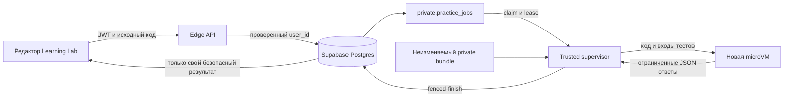

# Запуск кода и достоверная проверка практики

Статус: подробный проект, без внедрения и развёртывания. Дата проверки внешней документации: 2026-10-12, Europe/Moscow. Исходный checkout: `C:/Users/lomaster/.codex/worktrees/6209/rust_ml`, ревизия `827b443`.

Соседние документы определяют учебные шаги и схему Supabase. Здесь описан путь от редактора до серверного результата: API, очередь, изоляция Python/JavaScript/Rust, численная проверка и восстановление после сбоев. Пользователь выбирает основной язык; решения на остальных языках дают отдельные достижения. Сервер хранит успешность каждого языка, а учебный прогресс вычисляет по выбранному основному языку. [Модель данных](practice-data-model.md), [проект SQL](practice-schema.sql), [учебный проект](practice-system.md).

## Минимальная архитектура

Для первой версии нужны статический Learning Lab, Supabase Auth/Postgres, одна Edge Function с маршрутами API и отдельный runner. Очередь — таблица `private.practice_jobs` в том же Postgres; попытка и её job создаются одной транзакцией. Trusted supervisor runner получает работу через ограниченную роль `practice_worker`, запускает код в новой microVM и возвращает результат через закрытые функции БД. Внутри microVM нет сетевого доступа, ключей Supabase, токена пользователя и доступа к БД.



Здесь runner — постоянный доверенный сервис на Linux-хосте с KVM либо управляемый сервис, предоставляющий проверяемую эквивалентную изоляцию. Рекомендуемый технический профиль — Firecracker с production-настройками, jailer и отдельной microVM на попытку. Конкретный поставщик, регион, бюджет и способ эксплуатации остаются решениями следующего этапа; наличие Docker у поставщика само по себе не подтверждает этот профиль.

Supabase Edge Functions остаются коротким контрольным API. На дату проверки hosted-платформа документирует 256 MB RAM и 2 секунды CPU на запрос; wall-clock ограничение worker составляет 150 секунд на free и 400 секунд на paid, а request idle timeout — 150 секунд. Эти лимиты не являются бюджетом ученической программы. Rust-компиляция и пользовательский код туда не помещаются. `waitUntil` не превращает ограниченный worker в долговечный runner. [Лимиты Edge Functions](https://supabase.com/docs/guides/functions/limits), [Background tasks](https://supabase.com/docs/guides/functions/background-tasks).

`FOR UPDATE SKIP LOCKED` подходит для нескольких потребителей таблицы очереди; транзакция держит блокировку только на время получения/изменения job, а не на время исполнения. Это документированное применение PostgreSQL. [SELECT / locking clause](https://www.postgresql.org/docs/current/sql-select.html).

Supabase Queues/PGMQ — допустимая последующая замена механизма доставки, если она упрощает эксплуатацию при измеренной нагрузке. Вторую очередь одновременно с SQL jobs на MVP не добавляем. В PGMQ сообщение снова доступно после visibility timeout; `pop` удаляет его при чтении и может потерять работу при падении потребителя. Поэтому даже при переходе на PGMQ остаются lease/fencing и идемпотентная транзакция результата. Сообщение тогда содержит только `job_id`; `read`/`set_vt` и `archive` выполняет доверенный worker, а не браузер. Очереди не выставляются в публичный Data API. [PGMQ](https://supabase.com/docs/guides/queues/pgmq), [Права очередей](https://supabase.com/docs/guides/queues/quickstart).

## Два действия ученика

| Действие | Что выполняется | Что видит ученик | Влияние на прогресс |
| --- | --- | --- | --- |
| Изучить публичные примеры | Опубликованные входы, ожидаемые ответы, действующие численные уроки | Ручной разбор и вход/ожидаемый результат | Не засчитывает шаг |
| «Отправить на проверку» | Неизменяемая серверная попытка: public и hidden cases | Public-подробности и безопасные итоговые критерии hidden-проверки | Засчитывает только серверный `pass` |

MVP выполняет код Python/JavaScript/Rust только по «Отправить на проверку» через общий runner. Публичные примеры доступны для чтения/ручного расчёта и входят в серверную оценку с понятной обратной связью. Отдельного endpoint `/runs` и lifecycle публичного запуска в проектной SQL-схеме нет. Быстрый Python/JavaScript playground в браузере — следующее улучшение; отдельный удалённый public run для Rust потребует согласованного расширения job schema. Ни один такой запуск не даёт серверный успех. Браузер не отправляет доверенный `passed`, score, expected, bundle, seed закрытых тестов или право завершить шаг.

Если добавляется browser playground, код нельзя выполнять через `eval`/`Function` в основной странице учебника. JavaScript и Pyodide работают в уничтожаемом Worker отдельного playground-origin без сессии/ключей. Сам playground размещается в sandboxed iframe с `allow-scripts`, без `allow-same-origin`, навигации, popups, downloads и forms. CSP запрещает сетевые соединения во время исполнения; runtime/пакеты предварительно загружаются из фиксированных собственных статических assets. Вариант с opaque-origin iframe/Workers/Pyodide требует проверки совместимости в целевых браузерах перед включением. При невозможности выдержать ограничения playground не включается: остаются публичные примеры и серверная отправка.

Основная страница принимает сообщения только от конкретного iframe/MessagePort, проверяет nonce текущего запуска, тип, размер и схему. В playground не передаются access/refresh tokens, cookie, ответы hidden-проверки или локальное хранилище аккаунта. Основная страница по таймауту уничтожает iframe/worker целиком; все сообщения старого запуска игнорируются. Сетевые ограничения, изоляция origin и обработка сообщений проверяются в настоящем браузере, а не выводятся из наличия Worker.

Worker помогает не блокировать UI, но может иметь сетевые возможности; iframe/Worker не являются доказательством безопасности серверного произвольного кода и не защищают оценку от самого пользователя. Pyodide официально поддерживает выполнение в Worker; это механизм исполнения, а не доверенная проверка. [Pyodide в Worker](https://pyodide.org/en/stable/usage/webworker.html), [Web Workers](https://developer.mozilla.org/en-US/docs/Web/API/Web_Workers_API/Using_web_workers), [CSP sandbox](https://developer.mozilla.org/en-US/docs/Web/HTTP/Reference/Headers/Content-Security-Policy/sandbox).

## Контракт упражнения и языка

Проектная SQL-схема версионирует контент через immutable `release_id`. Внутри release есть semantic `exercise_key`, `exercise_id` и отдельный `variant_id` каждого языка. У variant фиксированы `entrypoint`, starter, public tests и `runtime_digest`; у private bundle — `bundle_sha256`, grading tests и `runner_spec`. `runner_spec` должен содержать версию solve-протокола, language, точные compiler flags, допуски, группы критериев и `limit_profile`. Значение `draft_revision` — CAS-версия исходника, а не версия учебного контента. Новая проверка/исправление опубликованного задания — новый release; job всегда использует закреплённые digest. Отзыв ошибочного release — отдельное production-требование, ещё отсутствующее в данном DDL.

Общий формат — заданная функция `solve(input)` с JSON-совместимым входом и выходом. Конкретное имя функции, типы и scaffold определяет contract шага. Например, у вычисления MSE вход содержит `predictions` и `targets`, выход — `loss` и при необходимости `gradient`; ввод/вывод и проверяемый математический смысл одинаковы во всех языках. Для Rust публикуются точные типы и готовый JSON shim, чтобы сериализация не подменяла учебную задачу.

| Язык | Runtime MVP | Пользовательский файл | Ограничения зависимости |
| --- | --- | --- | --- |
| Python | Закреплённый образ CPython | `solution.py` | Стандартная библиотека; без pip и скачиваний |
| JavaScript | Закреплённый образ Node.js, ESM | `solution.mjs` | Без npm и установок; Node является runtime внутри VM |
| Rust | Закреплённый rustc/toolchain и готовый shim | `solution.rs` | std и заранее собранный проверенный JSON shim; без Cargo manifest, build.rs, proc-macro и сетевого registry |

Точные версии выбираются и фиксируются при реализации, не определяются как `latest`. Образ содержит toolchain, публичный adapter и только нужные проверенные зависимости. У runtime digest есть версия протокола, архитектура CPU, compiler flags и digest adapter. Ученик не выбирает image, command, shell args, mount paths или лимиты.

Компилятор тоже обрабатывает недоверенные данные. Rust компилируется в отдельной compile-microVM с лимитами; результат переносится как ограниченный бинарный artifact в новую run-microVM. На хосте он никогда не выполняется. Команда компиляции строится как фиксированный argv, не через shell с подстановкой исходного кода. Даже `include_str!` видит только разрешённые файлы guest; доступа к private bundle нет. Сборка Python/JS не выдаёт права supervisor.

Перед каждым hidden case запускается новый процесс решения с чистым временным каталогом; при необходимости исключить влияние guest-состояния создаётся новая run-microVM. Public и hidden фазы используют разные чистые VM, поэтому stdout публичного теста не может прочитать оставшееся состояние hidden-фазы. Hidden inputs передаются по одному. Код может наблюдать текущий вход и сохранять/печатать его внутри VM — это неизбежное свойство black-box задачи; секретность expected и private test code сохраняется вне неё.

## Изоляция и ресурсы

Граница доверия проходит между supervisor и microVM. Guest agent, learner code, его JSON, binary artifacts, stdout, ошибки и exit codes считаются недоверенными. Supervisor имеет только ограниченный доступ к jobs/RPC и опубликованным bundle; API имеет отдельную роль. Никакие DB credentials, `service_role`, cloud credentials или environment хоста не попадают в VM, исходники, публичные assets, frontend `VITE_*` или ответы API.

Firecracker использует KVM и дополнительные process barriers; production-гайд требует обновления kernel/microcode, jailer либо эквивалентных ограничений и настройки ресурсов оператором. Firecracker сам не фильтрует сеть. Это требования к реализации и эксплуатации, а не утверждение, что запуск обычного образа уже безопасен. [Архитектура Firecracker](https://github.com/firecracker-microvm/firecracker/blob/main/docs/design.md), [Production host setup](https://github.com/firecracker-microvm/firecracker/blob/main/docs/prod-host-setup.md), [Jailer](https://github.com/firecracker-microvm/firecracker/blob/main/docs/jailer.md).

Обязательная конфигурация:

1. Новая microVM на попытку/фазу, уникальный host UID/GID, production seccomp, jailer, cgroups; guest code работает непривилегированным UID с запрещённым повышением привилегий. Отсутствуют host mounts, Docker socket, устройства и привилегированные capabilities.
2. Read-only root/runtime/public harness, отдельный ограниченный workspace/tmpfs. Никаких общих writable-каталогов между учениками, попытками и языками. Supervisor принимает artifact только из фиксированного файла с проверенными типом, размером и digest; архивы, пользовательские paths, symlinks и traversal не извлекаются на хост.
3. У VM нет сетевого интерфейса и MMDS/metadata secrets. Внешний firewall блокирует egress на случай ошибочной конфигурации; отдельно проверяются DNS, IPv4/IPv6, localhost, private network, metadata endpoint. Единственный guest-to-supervisor канал — ограниченный протокол без команд управления, доступа к файловой системе хоста и произвольных RPC.
4. Лимиты памяти VM и процесса, CPU всего дерева, wall-clock watchdog хоста, количество процессов/FD, размер workspace/artifact/stdout/stderr/результата, количество и глубина JSON. Ограничивается и компиляция, и исполнение, включая VMM/serial/log buffers. Измерять только CPU основного процесса недостаточно: child processes и busy guest тоже расходуют бюджет.
5. Таймаут, output limit, потеря lease и завершение уничтожают всю VM/process group; затем supervisor проверяет отсутствие VMM/процессов/файлов попытки. Периодический reaper удаляет только истёкшие ресурсы собственных run IDs после проверки ownership. При падении supervisor отдельный host watchdog продолжает cleanup.
6. Наблюдаемость хоста ограничена структурными метаданными: run/job ID, язык, digest версии, времена, потребление ресурсов, категория сбоя. Raw hidden inputs, source, stdout и токены не пишутся в общие logs. Хранилище исходников и срок его удаления определяются отдельной политикой аккаунта; доступ — только владельцу и минимально необходимым операторам.

Обычный Docker-контейнер, Node `vm`, language import blacklist и анализ текста исходника не заменяют границу sandbox. Node прямо предупреждает, что `node:vm` не является механизмом безопасности. gVisor — другой применимый класс sandbox, однако переход на него требует своей модели угроз и проверки совместимости; одновременно два runtime-слоя на MVP не нужны. [Node vm](https://nodejs.org/api/vm.html), [gVisor security architecture](https://gvisor.dev/docs/architecture_guide/intro/).

### Начальные профили для benchmark

Это предлагаемые значения, **не проверенные гарантии** выбранного поставщика или задачи. Испытания перед выпуском должны откалибровать их по самым тяжёлым корректным решениям всех языков и по злоупотреблениям. Нельзя публиковать SLA или включать проверку до такой валидации.

| Ресурс | Предложение MVP | Как проверить |
| --- | --- | --- |
| HTTP body / UTF-8 source | 128 KiB / 64 KiB | Boundary tests до и после лимита |
| Run VM RAM | 512 MiB, без swap | CPython/Node/Rust reference и memory bombs |
| Rust compile VM | 1 GiB, 1 vCPU, CPU 30 s / wall 60 s | Обычные решения, compiler-pathological source |
| Исполнение | 1 vCPU, CPU 4 s всего / wall 20 s на фазу; отдельный потолок на case | Все public/hidden cases, loop, sleep, child-process spam |
| Попытка целиком | Wall 90 s после claim, включая сборку/фазы/cleanup | Cold boot и медленный хост; нельзя бесконечно продлевать heartbeat |
| Workspace / artifact | 32 MiB / 8 MiB | Заполнение диска, oversized artifact |
| Public stdout + stderr | 16 KiB суммарно на фазу, truncation явно показана | Бесконечная печать и Unicode bytes |
| JSON ответа | 64 KiB/case, depth ≤16, bounded elements по contract | Oversize, duplicate keys, invalid UTF-8, NaN/Infinity, deeply nested JSON |
| Guest процессы / FD | 16 / 128 | Fork/thread/FD bombs; toolchain profile отдельный |
| Lease / heartbeat | 60 s в проектном SQL / предлагаемые 15 s; общий wall limit обеспечивает supervisor | Пауза worker, обрыв БД, stale finish |

Лимиты зависят от exercise profile, утверждаются автором на сервере и входят в bundle digest. Увеличение для конкретного учебного шага не даёт пользователю произвольного вычислительного бюджета. OOM самого guest при принятом профиле — ошибка решения; нехватка ресурсов хоста до старта VM — инфраструктурный сбой.

## Достоверная оценка

Private bundle — неизменяемый проверенный artifact, доступный только supervisor: описание критериев, генераторы входов, expected/oracle, tolerances, seeds, утверждённые reference solutions и release manifest. Он хранится отдельно от public bundle/frontend/build assets, с ACL и read-only доступом к опубликованной версии. Перед claim/исполнением supervisor проверяет digest. Подпись bundle нужна, если хранилище и доставка не защищают его происхождение; digest сам по себе не удостоверяет автора.

При реализации нужно зафиксировать покрытие `bundle_sha256`: canonical manifest с `grading_tests`, `runner_spec` и ссылками/digest oracle artifacts. `runner_spec` включает entrypoint/language, protocol version, adapter/compiler flags, profile и точные численные criteria; grading tests включают public и hidden cases с признаком видимости. Publication tool и supervisor используют одну canonicalization, например JCS для ограниченного JSON по RFC 8785; `jsonb::text` не считается автоматически JCS. Hash проверяется до исполнения. SQL сейчас хранит digest, но не пересчитывает manifest и не проверяет происхождение runtime image; это обязанность publication pipeline/supervisor. [JSON Canonicalization Scheme](https://www.rfc-editor.org/rfc/rfc8785).

Private asserts, expected outputs, oracle code и seeds не монтируются в learner VM. Она получает публичный shim и текущий вход. Supervisor рассчитывает expected и сравнивает выход за пределами guest. Ученическая запись `{"passed":true}` или изменение adapter внутри guest не выдаёт успех: протокол возвращает только значения решения, а все критерии применяет supervisor. Adapter является удобством вызова, а не защитой от подделки.

Минимальный протокол между guest и supervisor:

```json
{"protocol":1,"case_id":"opaque-current-case","value":{"loss":0.25,"gradient":[-0.5,0.5]}}
```

Транспорт имеет длину кадра и предел до чтения; это отдельный data stream, не mixed stdout. `case_id` сопоставляется с текущим запросом, не принимается как выбор теста. Один запрос допускает ровно один ответ; неизвестные поля, duplicate keys, неправильный protocol, несколько frames, shape/type mismatch и нечисловые значения отклоняются. JSON parse делается безопасным стандартным parser; нет `pickle`, `eval`, пользовательских serializer plugins, HTML execution или интерпретации stdout как команд. Если дополнительный FD/канал недоступен у поставщика, используется отдельный ограниченный JSON файл фиксированного имени, а не поиск произвольных файлов.

Итог строит supervisor, не guest. Проектный `finish_practice_job` принимает `outcome`, `passed_tests`, `error_kind` и уже очищенный `feedback` (≤8000 UTF-8 bytes); БД проверяет допустимость конечного состояния, диапазон counts и lease. Identity/version/digests берутся из attempt/variant. MVP возвращает status/verdict/counts и краткую безопасную диагностику; resource metrics остаются в защищённой telemetry supervisor. Структурированные public case results и criterion feedback потребуют versioned JSON schema/колонки с allowlist, прежде чем API начнёт их возвращать. Это расширение, не существующая гарантия SQL. Доверенный supervisor остаётся частью threat model: скомпрометированный worker может фабриковать оценки, поэтому его роль, деплой и audit ограничиваются; sandbox не устраняет этот риск.

| Группа | Что проверять | Пример |
| --- | --- | --- |
| Public | Малый ручной пример с полным разбором | MSE `[1,3]` против `[2,2]` = 1 |
| Hidden ordinary | Несколько других размеров/значений и server-generated variant | Loss нельзя захардкодить по одному примеру |
| Boundary | Допустимые крайние формы, отрицательные/нулевые значения, invalid-shape policy | Empty batch принимается или отклоняется согласно contract |
| Numerical stability | Extreme logits, mixed magnitudes, masked values | Stable softmax/BCE; все требуемые выходы finite |
| Finite difference | Независимая центральная разность для backward | `(L(w+h)-L(w-h))/(2h)` против возвращённого градиента |
| Metamorphic | Инварианты/эквиварианты без копирования реализации | Softmax invariant к общему сдвигу; loss invariant к общей перестановке пар |
| Tiny training | Малый фиксированный seed, loss/обновление на заданном шаге | Градиент уменьшает loss при согласованном малом η |

Не каждый шаг требует всех групп. Manifest содержит только релевантные критерии и обязательные группы, проверенные против reference и специально неверных решений. Обязательные группы нельзя обойти средним score: если неустойчивый softmax проходит обычные числа, но проваливает extreme logits, математический шаг не засчитан. Количество пройденных cases — диагностическая метрика, не равнозначная mastery.

Для чисел используется объявленная смешанная погрешность `abs(actual-expected) ≤ atol + rtol*abs(expected)`; формы, длины, integer IDs, mask и категориальные outputs проверяются точно. В contract есть precision, порядок уменьшения/reduction и допустимость equivalent outputs; UI округление не используется при оценке. Пример начального float64 допущения `atol=1e-8`, `rtol=1e-6` требуется откалибровать на конкретной операции; для finite difference выбираются отдельные `h` и допуск. Недифференцируемые точки ReLU не используются для численной проверки обычного градиента, если шаг явно не проверяет принятую subgradient convention.

Оценка сравнивает математическое поведение, а не исходный текст/файлы с эталонной реализацией. Для задач с несколькими правильными ответами проверяются свойства/эквивалентность, а не единственный snapshot. Стохастические учебные шаги используют фиксируемые seeds и малые детерминированные проверки; случайный единичный training run не доказывает правильность. Настройки маленьких моделей и данные не превращаются в скрытое требование обучить промышленную сеть или иметь GPU.

Private stdout/stderr, stack traces, expected, отдельные hidden inputs и seed не входят в пользовательский результат. Hidden feedback — название нарушенного критерия и авторская подсказка, например «проверь устойчивость при больших логитах». Public stderr можно показать ограниченно, с редактированием host paths/секретов и как plain text. Любой output в UI экранируется; пользовательский HTML не вставляется.

Скрытые тесты повышают качество проверки и препятствуют простому hardcode, но не доказывают авторство и не исключают перебор/запоминание. Получающий hidden input код способен вычислять функции от этого input; даже coarse pass/fail создаёт oracle. Уменьшать утечки помогают отсутствие hidden outputs, ограничение отправок, server-generated variants и versioned test bank. При появлении требования сертификации нужен отдельный процесс контроля; MVP не заявляет античит или доказательство понимания только по коду.

## Пользовательский API

Все пути — предлагаемый контракт одной Edge Function с базой `/functions/v1/practice-api`; они не реализованы. Public assets отдельно. Любой маршрут с аккаунтом принимает `Authorization: Bearer <Supabase access token>`. API проверяет подпись, issuer, audience, exp, допустимый алгоритм/тип токена и получает `user_id` из проверенного `sub`; `user_id` из тела игнорируется/отклоняется. Используется стандартная проверка Supabase `getClaims` для соответствующих JWT либо Auth `getUser`; локального Base64 decode недостаточно. HS256 legacy конфигурация требует Auth-server verification согласно документации. Publishable key не подтверждает личность. [Supabase JWT verification](https://supabase.com/docs/guides/auth/jwts), [Securing Edge Functions](https://supabase.com/docs/guides/functions/auth).

| Method / path | Auth | Тело / параметры | Успех |
| --- | --- | --- | --- |
| `GET /catalog` | Необязательна | Cursor, topic | `200`: public manifests; без private digest, jobs и закрытых условий |
| `POST /sessions` | Пользователь | `variant_id` опубликованного release/языка | `201`/`200`: owned session и draft; `start_practice` повторно возвращает ту же session |
| `GET /sessions/{id}` | Владелец | UUID | `200`: свой variant, draft, разрешённый контекст и status |
| `PATCH /sessions/{id}/draft` | Владелец | `source`, `draft_revision`, `origin=editor|guest_import` | `200`: новая revision; конфликт `409`, без silent overwrite другой вкладки |
| `POST /sessions/{id}/help` | Владелец | `help_key=hint:N|solution` | `200`: разрешённая подсказка/решение и durable help receipt в одной транзакции |
| `POST /sessions/{id}/attempts` | Владелец | `draft_revision`; Idempotency-Key UUID | `202`: snapshot сохранённого draft + immutable attempt + job; `Location` результата |
| `GET /attempts/{id}` | Владелец | UUID | `200`: queued/running/graded/error и safe result; чужой/отсутствующий ID одинаково `404` |
| `GET /progress` | Пользователь | Topic, cursor | `200`: только свои шаги, успехи по языкам и основной маршрут |
| `PATCH /enrollments/{release_id}` | Пользователь | `primary_language` | `200`: язык этого release и default preference; прошлые language successes сохранены |

Язык определяется выбранным `variant_id` и не меняется в draft/attempt request. Для другого языка клиент открывает его variant/session. Главный язык хранится в `practice_enrollments.primary_language` данного release; `practice_profiles.preferred_language` задаёт default для нового enrollment. Solve protocol/profile находятся в frozen `runner_spec`, поэтому клиент не передаёт и не выбирает их.

Никаких публичных `claim`, `renew`, `finish`, `set_passed`, `award_achievement` и обновления grade через Data API. Чтение draft/progress/attempt с RLS разрешает только owner; private таблицы/функции и полномочия worker не выдаются `anon`/`authenticated`. Narrow-role API вызывает серверные функции с проверенным владельцем. CORS разрешает конкретные frontend origins; это дополнительное ограничение browser access, а не заменитель JWT.

Пример отправки:

```http
POST /functions/v1/practice-api/sessions/SESSION_ID/attempts
Authorization: Bearer ACCESS_TOKEN
Idempotency-Key: CLIENT_GENERATED_UUID
Content-Type: application/json

{"draft_revision":7}
```

```json
{"attempt_id":"ATTEMPT_ID","status":"queued","poll_after_ms":1000}
```

Перед отправкой frontend сохраняет актуальный source через draft PATCH с известной CAS revision и получает новую revision. Затем генерирует один idempotency key на нажатие «Отправить» и повторяет неизменный `(session_id, draft_revision, key)` при network retry/обновлении страницы. Уникальность — по `(user_id, key)`; `submit_practice` сопоставляет session и revision, снимок хранит exact UTF-8 source и SHA-256. Тот же key/session/revision возвращает ту же attempt, не тратит новую quota и не создаёт job, даже если draft уже изменён. Тот же key с другой session/revision — `409 idempotency_conflict`. Если при первом submit другая вкладка успела сохранить draft, revision mismatch даёт `409 draft_conflict`; другой source незаметно не отправляется. Новое осознанное нажатие получает новый key. Отмена HTTP-запроса не удаляет уже принятую попытку.

API проверяет JWT, body и owner. Серверный `submit_practice` атомарно проверяет session/draft revision, существующий key и admission counts; берёт язык/версию из variant, source из saved draft, закрепляет runtime/bundle и assistance; создаёт attempt+job. SQL не содержит reservation ledger compute budget. Нельзя сначала вставить attempt, а потом enqueue отдельным запросом. При недоступной БД запрос не подтверждается как принятый. При неопределённом исходе клиент повторяет тот же key.

Чтение результата использует polling с backoff и паузой на hidden tab; предложенный старт — 1 s, затем до 5 s. Realtime/SSE не обязательны. `poll_after_ms` — совет API, не обещание времени исполнения. Уход из страницы/выход из аккаунта останавливает polling; после входа попытка находится по owner и id. Local draft сохраняется отдельно, пока logout/account deletion policy не требует его удаления.

| HTTP | Code | Смысл |
| --- | --- | --- |
| `400` | `invalid_request` | JSON/schema/UUID невалидны, неизвестные запрещённые поля |
| `401` | `unauthenticated` | JWT отсутствует, изменён, просрочен или не для этого проекта |
| `403` | `exercise_unavailable` | Аккаунт не допущен к действию; без чужих object details |
| `404` | `not_found` | Объект отсутствует или принадлежит другому пользователю |
| `409` | `idempotency_conflict` / `draft_conflict` | Осознанное разрешение конфликта; не автоматический новый key |
| `413` | `source_too_large` | Превышен размер body/source |
| `422` | `unsupported_variant` | Валидный запрос не подходит опубликованному варианту |
| `429` | `quota_exceeded` / `too_many_active_jobs` | Серверный лимит; `Retry-After` и safe reset time |
| `503` | `grading_unavailable` | API/БД/runner admission недоступны; safe retry тем же key |

Ошибка решения после принятия попытки — результат `GET` с `200`, а не transport `500`. Обёртка ошибок API: `{error:{code,message,request_id,retryable}}`; сообщения не содержат токены, SQL, private source или stack хоста. `request_id` связывает безопасные logs, не даёт доступ к ним.

## Claim, lease и завершение

Названия/DDL задаёт [проект SQL](practice-schema.sql). Состояния attempt: `queued → running → graded` либо `error`; job: `queued → leased → finished`, с возвратом `leased → queued` для infrastructure retry. `graded` имеет `verdict=pass|fail`; синтаксическая ошибка, неверные числа, runtime error, time/memory/output limit — `graded/fail` с `error_kind`. Инфраструктурный сбой после исчерпания retry — `error`, без ложного математического fail. Retry внутри той же attempt — свойство job, не новая ученическая отправка.

Точный закрытый контракт SQL:

| Function | Доверенный caller | Вход / выход |
| --- | --- | --- |
| `private.submit_practice` | `practice_api` | Verified user UUID, session UUID, key UUID, draft revision → attempt UUID |
| `private.claim_practice_job` | `practice_worker` | Нет аргументов → null либо job/attempt ID, token, generation, lease_until, source/hash, runtime/bundle digest, grading_tests, runner_spec |
| `private.renew_practice_job` | `practice_worker` | Job UUID, token UUID, generation integer → boolean |
| `private.finish_practice_job` | `practice_worker` | Job UUID, token UUID, generation, outcome=`pass|fail|infrastructure`, passed integer/null, error text/null, safe feedback text/null → attempt status |

`claim` возвращает private grading data только trusted supervisor; этот payload никогда не пересылается в guest или browser целиком. Supervisor должен проверить pinned digests и собирать минимальный вход VM самостоятельно.

1. **Submit.** Одна транзакция сериализует admission пользователя через profile lock, проверяет idempotency, создаёт immutable attempt и ровно один durable job. Source/session/release/runtime/bundle/assistance после принятия не изменяются. Прогресс ещё не появляется.
2. **Claim.** Закрытая функция выбирает eligible job с `FOR UPDATE SKIP LOCKED`, включая `leased` с истёкшей lease. В той же транзакции увеличивает `lease_generation`, создаёт случайный `lease_token`, задаёт `lease_until=DB time+60s` и отмечает attempt `running`. Возвращает payload с закреплёнными digest. Доступ определяется trusted DB role, не полем learner request; отдельной worker identity в текущей таблице нет. Транзакция сразу заканчивается.
3. **Run.** Supervisor проверяет bundles, создаёт fresh sandbox, выполняет compile/public/hidden, измеряет ресурсы и периодически вызывает renew. Все control-plane credentials остаются за пределами VM. Для невосполнимой потери lease прекращает собственный запуск и не отправляет оценку.
4. **Renew.** Только matching `job_id + generation + token`, state leased и **ещё не истёкшая** lease продлевают срок на 60s от времени БД. Проверка и update атомарны; поздний heartbeat не оживляет lease. SQL не ограничивает суммарное число продлений: общий wall limit обязателен в supervisor; DB deadline — дополнительное усиление при реализации.
5. **Finish.** Одна транзакция блокирует job и attempt, проверяет token/generation и непросроченную lease, вычисляет hash scalar arguments; записывает terminal result и закрывает job. CHECK constraints проверяют outcome/counts/error. Runtime/bundle совпадение и guest JSON schema проверяет supervisor: RPC их не получает. SQL progress view производит агрегат из committed attempts, поэтому отдельной несогласованной записи прогресса нет. Materialized achievements, если добавляются, должны иметь уникальный ключ и атомарную запись в этой транзакции.
6. **Receipt replay.** Сохраняются hash scalar arguments и token/generation принятого lease. Повтор идентичного finish после потери ответа возвращает status как no-op, даже когда прежний срок lease уже истёк; другая оценка с тем же token либо старое поколение отвергаются. Это работает и для явного infrastructure результата в `queued` до нового claim. Replay не перезаписывает результат и не создаёт новый progress факт.
7. **Recovery.** После crash невыполненная job доступна новому claim после expiry/backoff. Поколение растёт; запоздавший finish прежнего worker получает `stale_lease` и не меняет БД. Частичные guest outputs не используются. Необратимого ack до commit нет; для SQL queue terminal flag и результат живут в той же транзакции.

Это **at-least-once исполнение с единственным применением результата/прогресса**, а не обещание единственного физического запуска. Во время network partition две VM могут кратко работать одновременно; fencing блокирует второго победителя, а watchdog ограничивает потерянное вычисление. Lease сама по себе не защищает от stale записи без проверки token/generation в finish.

Если supervisor сохранил валидный результат, а БД временно недоступна, он может повторять finish с тем же digest пока lease действует. После expiry результат старого запуска не принимается; новый worker выполняет заново. Если commit прошёл, но ответ потерян, receipt replay определяет успех. Утрата диска worker не должна терять job или статус пользователя.

Инфраструктурные повторения в проектном SQL: максимум три lease generation, backoff 5 s при явном infrastructure finish; expiry тоже расходует generation. Причины — VM boot, проверенная ошибка доставки, host crash, временная БД. Ошибки ученика не перезапускаются автоматически. Отсутствие/несовпадение bundle digest классифицируется supervisor как configuration/infrastructure failure; circuit breaker для версии нужен в production, но его нет в SQL. После исчерпания retry attempt `error/infrastructure`; повторная проверка пользователем создаёт новую attempt. Операторский regrade — отдельное расширение с audit, не silently заменяет старый source.

Server pass хранится как terminal attempt своего variant. Progress view агрегирует наличие подтверждённого pass по variant, включая `assistance=none` для independent результата; более поздний fail не стирает предыдущий pass. Success в дополнительном языке не выдаёт достижение другого языка. Topic completion выводится из обязательных variants выбранного primary language данного release; смена языка меняет текущий aggregate, но не удаляет историю. Durable help receipts не сбрасываются новой вкладкой; assistance snapshot берётся при submit. Схема не доказывает отсутствие внешней помощи и не хранит отдельные materialized achievement rows.

## Quota и справедливость очереди

Проектный SQL admission ограничивает одного пользователя: максимум две queued/running attempts, 10 submits за rolling minute, 200 за rolling 24 hours (terminal infrastructure исключается из суточного счётчика). Это предложенные значения, не проверенная пропускная способность/тариф. Edge account/IP rate limits, глобальная admission/queue capacity и compute cost budget ещё не реализованы; их нужно задать после benchmark/бюджета. При большой очереди API заранее возвращает `429/503`, а не принимает бесконечно работу с неизвестным сроком.

Проверка counts и создание attempt выполняются под одним profile row lock. Три одновременных отправки при лимите двух должны принять ровно две; клиентский disabled button этого не гарантирует. Idempotency replay не создаёт attempt; retries одной job не считаются новыми assessment attempts. Compute accounting и число учебных ошибок разделяются: infrastructure не ухудшает mastery, но реально израсходованный compute контролирует supervisor/оператор. Quota reservation/refund ledger отсутствует в DDL и понадобится только при формальной тарификации; refunds тогда обязаны быть идемпотентными.

Supervisor не claim больше задач, чем может одновременно изолировать. SQL сортирует eligible jobs по `available_at,id` и ограничивает активные attempts пользователя; strict fairness по аккаунтам не реализована. MVP использует однородный worker, способный выполнить все опубликованные языки/profiles: claim сейчас не фильтрует возможности worker. Наблюдать нужно queue age, active slots, boot/compile/run wall time, timeout/OOM/output-limit по language/profile, retry count, rejected/stale finish и число infrastructure errors. В публичной метрике нет source, hidden data или идентификаторов других учеников.

## Кэш и минимальные зависимости

В MVP не нужен кэш оценок: каждый submit имеет понятный новый результат, а network retry устраняет idempotency. Если Rust compilation станет измеренным узким местом, допустим отдельный compile cache с ключом SHA-256 от canonical manifest полей `exact_source`, `runtime_digest`, `adapter_digest`, `compiler_flags`, `target_arch`, `contract_version` (без неоднозначной конкатенации строк). Кэш содержит только недоверенный binary artifact, ограниченный по размеру/TTL; он всегда запускается в fresh VM. Смена runtime/flags автоматически инвалидирует ключ. Private test inputs/results в кэш не входят, grade не переиспользуется между release/вариантами/языками.

Разделение по user namespace безопаснее для первого cache, чтобы hit/miss не раскрывал совпадение чужого source. Cross-user dedup, prewarmed learner snapshots, autoscaling, GPU, dependency installs и произвольный project/filesystem ввод не включаются до подтверждённой потребности и отдельной проверки. Warm runtime snapshot, если понадобится, содержит только pristine runtime и не сохраняет код/память/secret/state ученика.

## Матрица приёмки реализации

Все пункты ниже — будущие обязательные проверки, **они не выполнены этим проектным документом**. Для результатов записываются checkout/revision, runtime/bundle digests, provider/region, profile, команда и наблюдаемый outcome. Изменение runtime, schema или grader требует повторить затронутые проверки.

| Проверка | Действие | Требуемое доказательство |
| --- | --- | --- |
| Математическая верность | Reference Python/JS/Rust, hand-worked cases, FD/metamorphic | Все релевантные критерии проходят во всех языках |
| Проверка плохих решений | Hardcode public answers, wrong gradient sign, unstable logits, shape mismatch | Manifest ловит каждую перечисленную ошибку; correct equivalent implementation проходит |
| Подделка grade | Вывести `passed=true`, переписать guest adapter, отправить fake grade через API/Data API | Только actual output оценивается; fake finish недоступен |
| JWT tampering | Изменённая signature/sub, expired, wrong issuer/audience, publishable key вместо login | `401`, нет attempt/job или чужого чтения |
| Межпользовательский доступ | Два аккаунта, guessed IDs, Supabase direct REST/RPC, draft/source reads | Чужое чтение `404`/RLS denial; запись grade/lease невозможна |
| Idempotency | Тот же key/session/revision 20 раз параллельно; затем изменить session/revision | Одна attempt/job в admission counts; изменённый request `409` |
| Quota race 1/2/3 | При двух active slots одновременные submissions и новый session | Ровно две accepted; третий `429`; нельзя обойти другой вкладкой/языком |
| Concurrency claim | Несколько workers, одна eligible job | Один активный lease generation; независимые jobs параллельны |
| Crash recovery | Убить worker до запуска, во время compile/run, до/после DB commit | Job возвращается после expiry; terminal receipt/progress ровно один |
| Stale worker | Expiry → новый claim → старый renew/finish | Старое поколение отвергнуто; результат нового worker сохранён |
| Lease lost | Оборвать БД/заморозить supervisor | Host watchdog убивает VM; поздняя оценка не принята |
| Flood/OOM/loop | Infinite loop/sleep, fork/FD bomb, huge stdout/JSON/workspace | Принятый профиль срабатывает; host и другие jobs сохраняют доступность |
| Secret/network isolation | Читать env/host paths, DNS/HTTP/IPv6/metadata, guest control channel abuse | Нет credentials/host data/egress; все обращения к control plane запрещены |
| Hidden leakage | Печатать input, читать expected/private bundle, exception with hidden value | Private bundle недоступен guest; hidden stdout/stack/values отсутствуют в API/logs/frontend |
| Artifact tampering | Oversize/symlink/traversal, altered compiler cache digest | Хост не исполняет/не извлекает опасные paths; artifact отклонён |
| Release consistency | Изменить bundle/runtime между enqueue и claim | Published release mutation запрещена SQL; повреждённая доставка обнаружена supervisor по digest |
| Progress consistency | Pass → fail; pass в другом языке; duplicate finish; смена primary | Лучший pass сохраняется; language aggregates верны; derived completion воспроизводим; future materialized achievement уникален |
| Browser UX | Desktop/mobile, keyboard, cancel, timeout, logout, refresh, delayed response | Редактор/фокус работают, старые сообщения игнорируются, server result восстанавливается |
| Browser sandbox (следующий этап) | Worker + CSP + iframe на поддержанных браузерах, exfiltration probes | Нет доступа к аккаунту/parent/network; при несовместимости playground отключён |
| Account lifecycle | Logout, session expiry, удаление аккаунта, retention cleanup | Политика исходников соблюдена; old JWT не выдаёт чужих данных; job cleanup завершён |

Перед реальным включением остаётся выбрать sandbox-поставщика/оператора и регион, проверить KVM/isolation capabilities, измерить профиль и стоимость, реализовать/version проверить RPC и RLS, опубликовать bundles, пройти эту матрицу и определить сроки хранения source/операционных logs. Эти внешние решения не мешают утвердить контракт проекта, но без них нельзя назвать runner готовым или безопасным.
