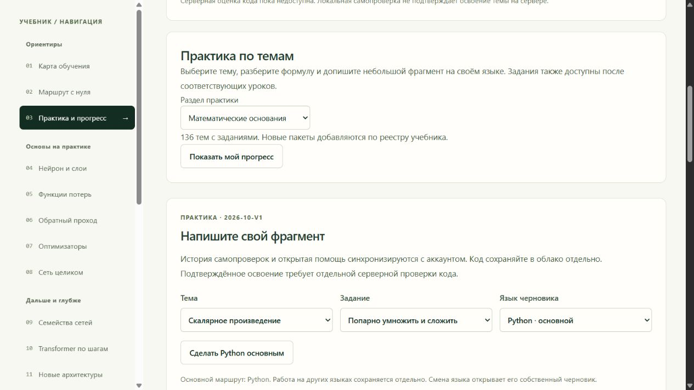
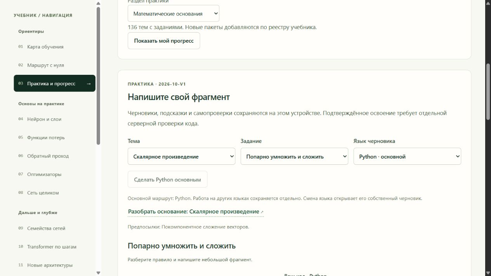
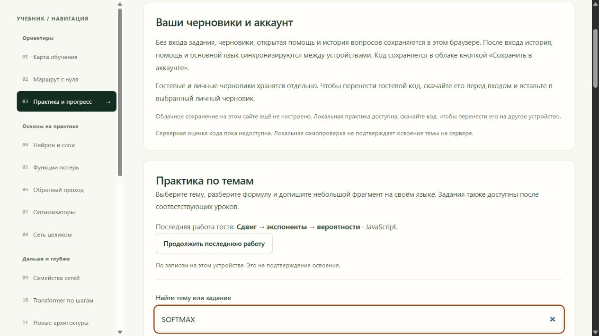
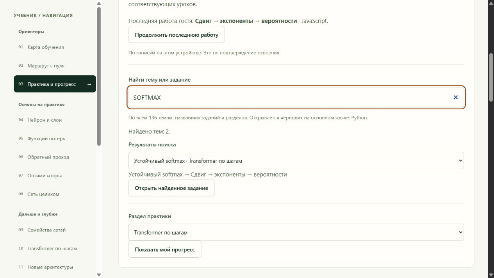
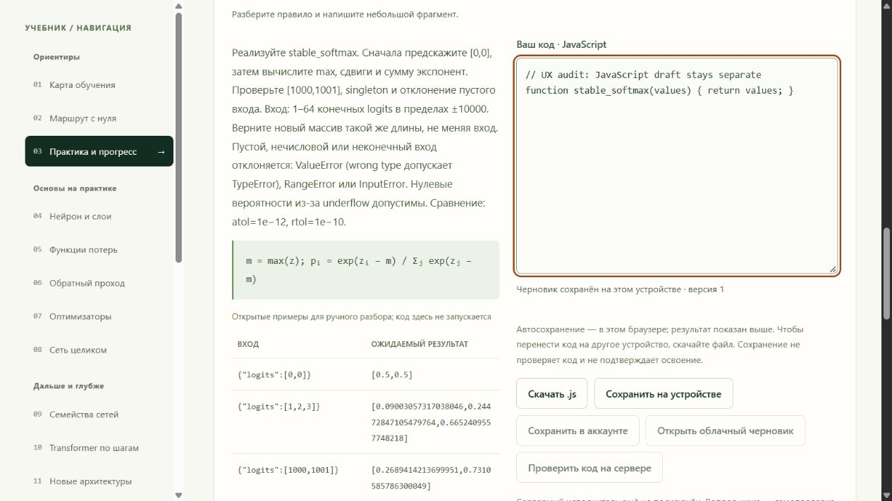

# Практика: поиск, продолжение и сохранение

Checkpoint 2026-10-13 (Europe/Moscow). Авторитетный комплексный план остаётся
в корневых PLAN.md / PROGRESS.md и обновляется родительским чатом.

Checkout: `C:/Users/lomaster/.codex/worktrees/6eed/rust_ml`.
Ветка: `codex/practice-ux-navigation`; проверенная база:
`1e3ba80b9056489ec2aceacfdfaef383b52d8936`. Финальный срез — commit, содержащий этот
checkpoint. Корневые планы, master, каталог, cloud provider, sync, grader, DB,
contracts/IDs/fixtures и settings не изменялись. Merge/deploy — родителю.

## Screenshot-аудит и изменения

1. Опубликованный `https://iliskhan.github.io/rust_ml/#practice` открыт read-only
   в IAB; screenshot сохранён до реализации. Доступен выбор раздела, затем
   длинный dropdown темы. Среди 136 тем нет отдельного поиска заданий.
   Исправлено: поиск по словам без учёта регистра в названиях раздела, темы и
   задания. Результат выбирается native select; конкретное найденное упражнение
   открывается на основном языке. Нет фильтрации/миграции черновиков.
   
2. Локальный исходный UI также осмотрен до изменений. Продолжение было доступно
   только внутри раскрываемого прогресса. Исправлено: видимая кнопка последней
   записанной работы по всем языкам текущего владельца и выпуска. Используются
   `readLearningProgress` и его `continueWith`, без нового хранилища/событий.
   Язык и ограничения локальных сведений подписаны; нет рекомендаций/освоения.
   
   
   
3. Статус «Черновик сохранён» раньше не называл устройство. Исправлено:
   «Черновик сохранён на этом устройстве», «Сохранить на устройстве», короткая
   подпись автосохранения, переноса и отсутствия проверки кода. Аналогичная
   локальная подпись исправлена в подробностях прогресса. Облачный успех
   продолжает показывать только существующий callback сохранения.
   

Сохранённые PNG открыты и визуально осмотрены. Desktop1280×720, неизменённый общий
viewport. Навигационные controls и фокус читаемы; горизонтального overflow нет
(`scrollWidth1265 <= innerWidth1280`). Console error/warn: пустой список.
Все снимки — настоящий UI; код в редакторе — явно подписанный тестовый draft,
не исполненный результат. Аккаунт на public site не изменялся; screenshot с
почтой не сохранялся. Локально public cloud config не задан, проверялся guest UI.

## Проверки

Рабочая директория всех frontend команд: `<checkout>/learning-lab`.
Node `C:/Users/lomaster/.cache/codex-runtimes/codex-primary-runtime/dependencies/node/bin/node.exe`
24.19.0; Python в соседнем `dependencies/python/python.exe`; rustc1.87 — прямой
`C:/Users/lomaster/.rustup/toolchains/stable-x86_64-pc-windows-msvc/bin/rustc.exe`.
Dependencies установлены `pnpm install --frozen-lockfile` из прежнего lockfile.

```powershell
$env:PATH='C:/Users/lomaster/.cache/codex-runtimes/codex-primary-runtime/dependencies/node/bin;C:/Users/lomaster/.rustup/toolchains/stable-x86_64-pc-windows-msvc/bin;' + $env:PATH
$env:PRACTICE_VERIFY_ALL_LANGUAGES='1'
$env:PRACTICE_RUSTC='C:/Users/lomaster/.rustup/toolchains/stable-x86_64-pc-windows-msvc/bin/rustc.exe'
$env:PRACTICE_PYTHON='C:/Users/lomaster/.cache/codex-runtimes/codex-primary-runtime/dependencies/python/python.exe'
node --test tests/*.test.ts
node C:/Users/lomaster/.cache/codex-runtimes/codex-primary-runtime/dependencies/node/node_modules/pnpm/bin/pnpm.mjs build
```

- Full suite535/535 PASS, failed0, skipped0; `practice-ux-tests.txt`.
- Two added tests cover multi-word/course/exercise/case/empty search and
  continuation across languages, guests/accounts, releases, corrupt records,
  with no writes. Existing isolation/numerical/author-adapter tests retained.
- `tsc --noEmit` PASS; final `pnpm build` PASS, `practice-ux-build.txt`.
  Existing >500kB chunk warning remains; dependencies/chunk policy unchanged.
- `git diff --check` PASS.
- Real browser: search SOFTMAX → two topics → Enter opens guided softmax and
  focuses textarea; AdamW → single topic; missing word → useful empty state.
- Real browser: distinct Python/JavaScript softmax drafts auto-save; navigate
  via search to AdamW without editing; Continue restores latest JavaScript
  draft; language switch restores Python; reload → Continue restores JS again.
  Native selectors/labels retained; real keyboard Enter verified.
- Final progress details render «Черновик сохранён на этом устройстве» after
  opening the existing softmax summary. Save/help/quiz are not server mastery.

Environment limitations resolved: sandbox registry EACCES → install escalation;
esbuild Access is denied reading ancestor/config → dev/build escalation;
full suite first reached rustup denied temp write → direct installed rustc and
explicit environment on permitted test run. No settings were weakened. First
pnpm build spawned Node18 from PATH; final build uses Node24 PATH explicitly.

## Следующие действия родителя

1. Review/cherry-pick ветки; повторить затронутые проверки после объединения.
   Обычный push этой ветки и remote SHA проверяются перед итоговым ответом.
2. Mobile390 и320 оставлены родителю по явному browser slot ограничению; этот
   checkout не менял общий viewport. Локальный сервер только порт6972, session90919,
   IAB tab2 оставлен для handoff. Проверить на обоих размерах: поиск SOFTMAX,
   выбор второго результата native select, Enter/open, длинная подпись задания,
   локальный статус и скачивание/сохранение controls; затем отдельные Python/JS
   drafts → AdamW → Continue → reload. Проверить `scrollWidth <= innerWidth`,
   видимый focus, mobile16px inputs и44px buttons; сохранить screenshots.
3. После интеграции configured account UI: проверить вход/выход и смену владельца
   (recent guest не показывается как account, account не показывается другому),
   primary Rust → search opens Rust, Continue opens реальный последний язык,
   cloud save → edit показывает локальный результат, без ложного cloud успеха.
   Owner/release/language изоляция в логике уже проверена suite.
4. Grader остаётся disabled до исходного pending approval; в этом scope он не
   включался и не проверялся hosted. Подтверждённая mobile/account приёмка и
   merge/deploy относятся к следующему интеграционному этапу, не заявлены здесь.
