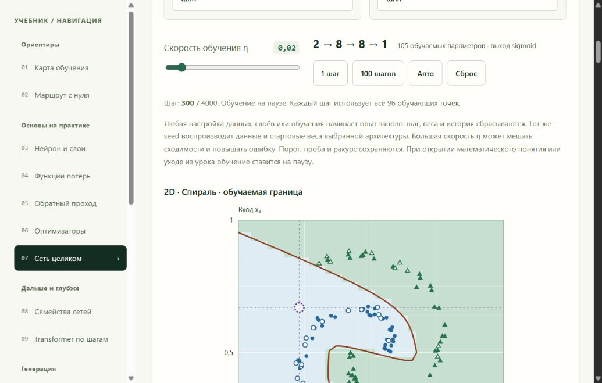
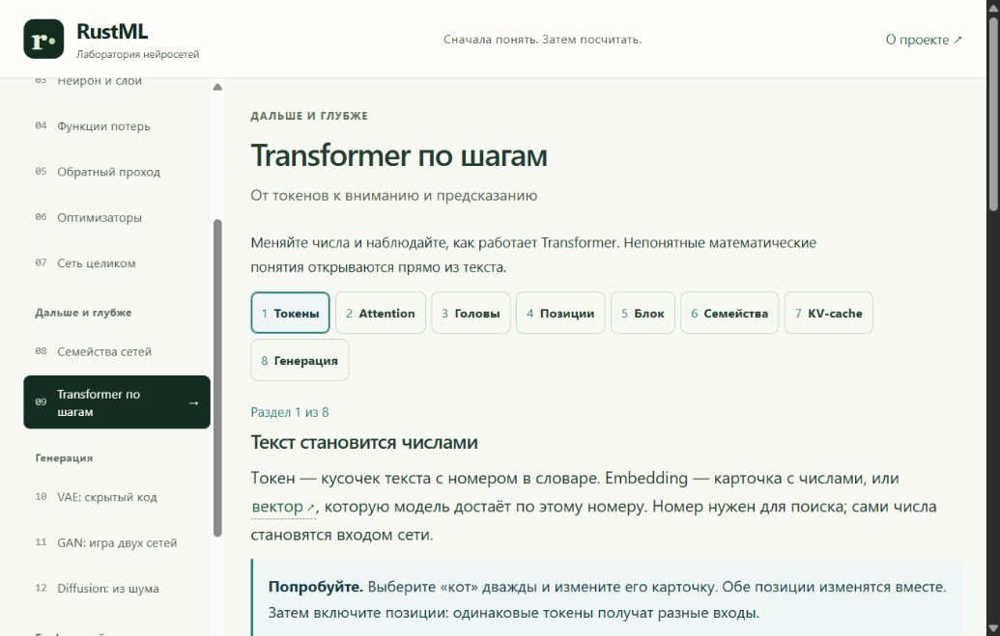
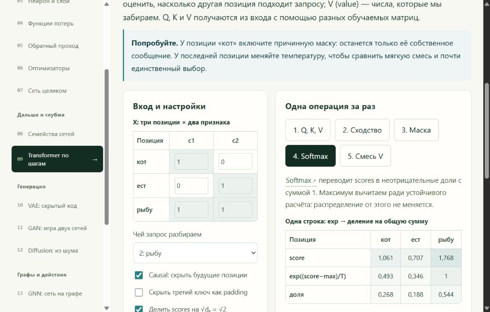
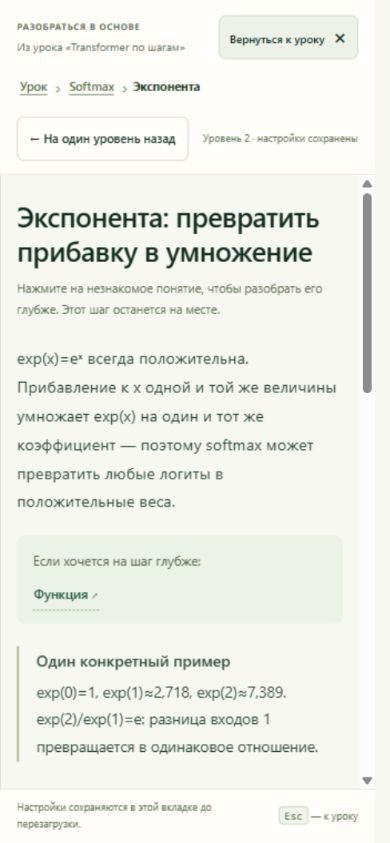
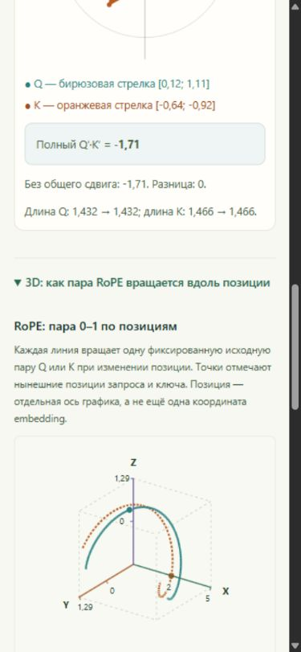
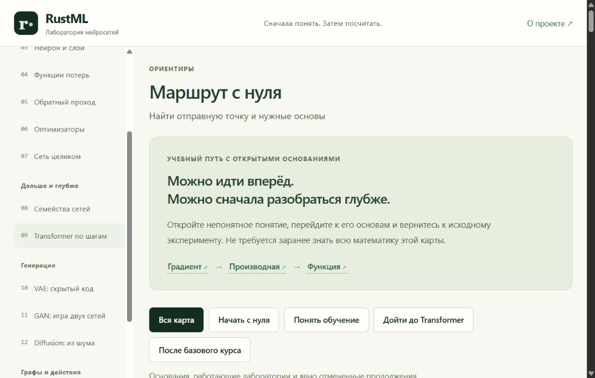

# Проверка текущего интерфейса для аудита визуализаций

Дата: 2026-10-11, Europe/Moscow. Checkout: `C:/Users/lomaster/Desktop/dev/rust_ml`,
`master`, исходники `09506e5008b7e603a8ee397af3f1f15e42024063`.
Проверка production preview `http://127.0.0.1:5182` через Codex In-app Browser,
tab 3. Это выборочный аудит сценария, а не повторная полная приёмка учебника.

## 1. Обученная сеть и карта решений — работает

Desktop 1050×668. Сохранённый эксперимент: спираль, 2×8 tanh, Adam,
шаг 300, порог .51. Кнопки обучения, размер сети и 2D-карта находятся в одной
лаборатории; реальные числа и предупреждение о сбросе видимы. Этот запуск не
обучался заново в аудите. Изображение показывает текущую область прокрутки.

Возможность улучшения: предложить начинающему ограниченный опыт «один слой /
два слоя на тех же данных», затем раскрывать все настройки. Это рекомендация,
а не доказательство того, что текущие настройки мешают пользователям.

## 2. Вход в Transformer — ясная структура

Desktop 1050×668. Восемь подписанных разделов, номер текущего раздела,
простое объяснение embedding и инструкция «Попробуйте» видны в настоящем UI.

Возможность улучшения: связывать действия с общей схемой пути токена через
Transformer, оставляя матрицы для подробного разбора. Схема обозначает топологию
вычислений; её расположение не должно изображать координаты embeddings.

## 3. Attention, шаг softmax — реальные числа, геометрия раскрыта слабо

Desktop 1050×668. Переключён раздел Attention, затем шаг «4. Softmax».
Вход и расчёт показаны рядом. Выбран query 2; scores примерно
`[1.061; .707; 1.768]`, доли `[.268; .188; .544]`. Таблица вычислений —
сильная сторона; геометрическая интуиция Q/K и смеси V на этом экране не видна.

Открытие ссылки Softmax показывает самостоятельный пример с логитами
`[2; 1; 0]` и долями `[.665; .245; .090]`. Ошибки в этом нет. Предложение:
добавить явный выбор «разобрать мои числа», передавая снимок выбранной строки,
температуры и маски, и отдельно сохранить свободный пример.

## 4. Вложенное математическое погружение — возврат работает

Mobile 390×844: Attention → Softmax → Экспонента, уровень 2. Хлебные крошки,
кнопки возврата и название исходного урока доступны. Принят стабильный снимок
после применения mobile viewport; первый переходный кадр не использован.

Возврат на один уровень, затем к уроку сохранил «4. Softmax» и query 2.
Ширина документа после возврата: clientWidth=375, scrollWidth=375,
то есть горизонтального переполнения в этом состоянии не наблюдалось.
Рекомендация: рядом с возвратом кратко показывать исходную строку/шаг и числа,
чтобы после долгого погружения проще восстановить мысль.

## 5. Существующий RoPE в 3D — оси имеют явный смысл

Mobile 390×844: раздел «Позиции», открыта сцена «RoPE: пара 0–1 по позициям».
Параллельно доступны плоские стрелки, dot product и сохранение длин.
Оси 3D — позиция, координата 0 и координата 1 после RoPE; текст явно отделяет
позицию от координат embedding и от расчёта dot product. Повторять эту сцену
в новом плане не нужно.

clientWidth=375, scrollWidth=375. Видимый кадр — часть длинной страницы,
а не доказательство отсутствия любых наложений во всех ракурсах. Контроль
с клавиатуры здесь не повторялся; полной accessibility-проверки нет.

## 6. Маршрут с нуля — предпосылки и уровень готовности обозначены

Desktop 1050×668. Есть выбор маршрута, ссылки градиент → производная → функция
и уровни «Интерактив», «Разбор», «Следующий уровень». В DOM отдельно обозначены
ограничения training и industrial variants. Возможность улучшения: актуализировать
связи карты с новой лабораторией границ и отличать реализованный embedding lookup
от ещё не реализованной полной токенизации.

## Ограничения и сохранение состояния

Осмотрены шесть указанных состояний. Этот аудит не доказывает качество обучения
по наблюдению пользователей, полноту охвата всех глав, отсутствие дефектов при
любых настройках или соответствие WCAG. Console warn/error, возвращённые
инструментом для проверенной вкладки: 0. Исторические 154 теста не запускались
заново, поскольку исходники и конфигурация в этой задаче не меняются.

Мобильный viewport сброшен. Вкладка возвращена к `#network`, подтверждён шаг 300
сохранённого эксперимента. В ходе аудита не нажимались обучение или сброс.
